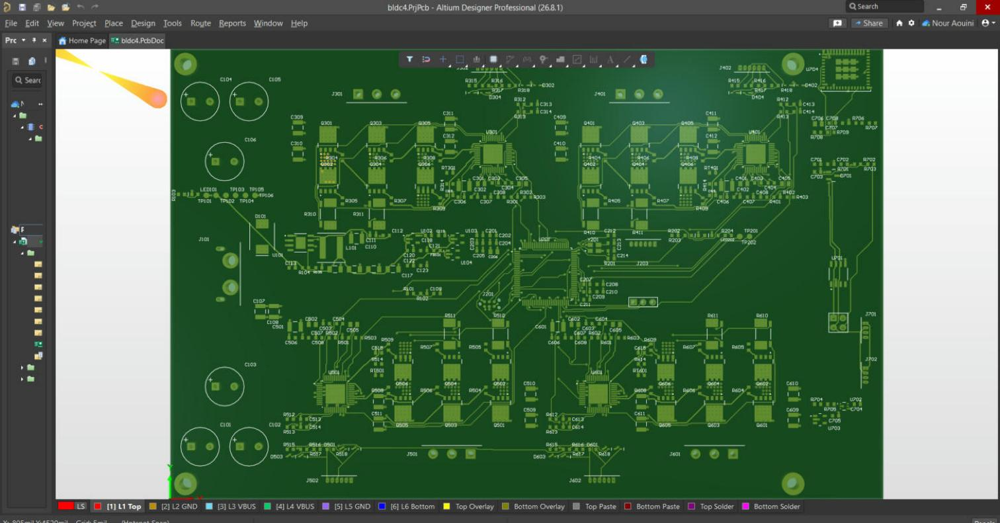
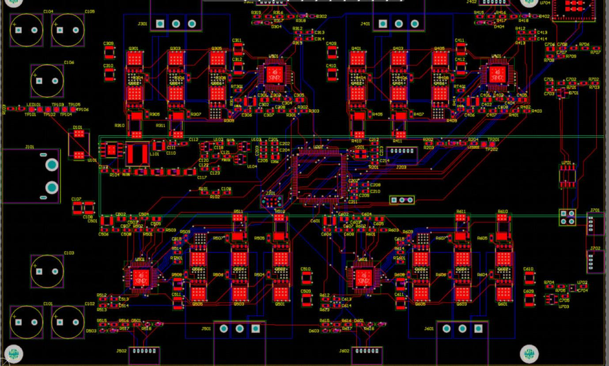

# BLDC-4 — Contrôleur FOC 4 axes sur STM32G474

Carte de commande pour **4 moteurs brushless** en commande vectorielle (FOC),
pilotée par **CAN FD**, avec une télémétrie WiFi (ESP32-C3) séparée de la
partie temps réel.

> **Projet en cours.** Firmware de commande, simulation Simulink et schéma
> Altium terminés. PCB : puissance routée, routage des signaux en cours.
> La carte n'est pas encore fabriquée : les résultats viennent de calculs,
> de simulations et de tests sur PC.

## En bref

- **MCU** : STM32G474 (Cortex-M4F, 170 MHz), 4 drivers DRV8305, 24 MOSFET, codeurs AS5047P
- **Boucle de courant** à 20 kHz, bande passante 1 kHz, marge de phase 63°
- **Firmware** en C, sans HAL dans la partie commande, validé par des tests unitaires
- **Simulink** : le code du firmware est simulé face à un modèle de moteur (SIL)
- **PCB** 6 couches, 190 × 120 mm, conçu sous Altium Designer

## Aperçu

PCB sous Altium (vue 3D) :

PCB, toutes couches :

Modèle Simulink : le bloc orange est le code du firmware, compilé et exécuté
face au moteur simulé.

Démarrage simulé : calibration, alignement du rotor, montée à 3000 tr/min,
puis charge.

## Documentation

- [Cahier des charges](docs/00-cahier-des-charges.md)
- [Réglage des boucles](docs/05-reglage-boucles.md) et [architecture du firmware](docs/06-architecture-firmware.md)
- [Conception du PCB](docs/10-conception-pcb.md) et [routage](docs/11-routage-liaisons.md)
- [Modèle Simulink](docs/12-modele-simulink.md)

## Suite

- [ ] Terminer le routage du PCB, puis le faire fabriquer
- [ ] Pilotes bas niveau du STM32 et firmware de l'ESP32
- [ ] Essais sur moteur réel

---

© 2026 Nour Aouini — tous droits réservés.
