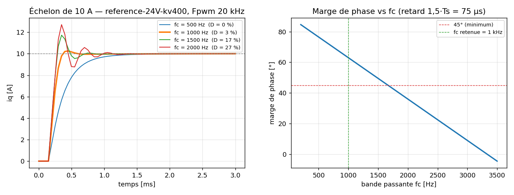

# Réglage des boucles

Dimensionnement **analytique**, puis vérification par **deux simulations
indépendantes** (Python et test C en boucle fermée sur le code firmware réel).
La simulation sert à valider, pas à dimensionner.

Moteur utilisé : moteur de référence
(24 V, Kv 400, 4 paires de pôles, Rs 0,2 Ω, Ls 150 µH). **À remplacer** par le
moteur réel : il suffit de modifier le JSON et de relancer les deux scripts.

## Boucle de courant

Le moteur vu par la boucle de courant est un premier ordre
`i(s)/v(s) = 1 / (Ls·s + Rs)`, de constante de temps `τe = Ls/Rs = 0,75 ms`.
On choisit un PI en **compensation pôle-zéro** : le zéro du régulateur annule le
pôle du moteur, et la boucle fermée devient un premier ordre pur de pulsation ωc.

```
Kp = ωc · Ls        Ki = ωc · Rs        (Ki/Kp = Rs/Ls)
```

La chaîne numérique ajoute un retard d'environ **1,5·Ts = 75 µs** :
échantillonnage, calcul, puis application au cycle PWM suivant. Ce retard limite
la bande passante utile :

```
marge de phase = 90° − ωc · 1,5·Ts
```

| fc | Kp [V/A] | Ki [V/(A·s)] | Marge de phase | Dépassement | Établissement 2 % |
|---|---|---|---|---|---|
| 500 Hz | 0,471 | 628 | 76,5° | 0 % | 1 003 µs |
| **1 kHz** | **0,943** | **1 257** | **63,0°** | **2,6 %** | **380 µs** |
| 1,5 kHz | 1,414 | 1 885 | 49,5° | 17,3 % | 540 µs |
| 2 kHz | 1,885 | 2 513 | 36,0° | 27,1 % | 822 µs |

**Retenu : fc = 1 kHz** (Fpwm/20). Au-delà de 1,5 kHz, la marge passe sous 45° et le
temps d'établissement **augmente** malgré la bande passante plus élevée, à cause
des oscillations.



### Validation croisée

Le test C `test_current_step_response` exécute le
**code firmware réel** (`foc_axis_isr`) sur un modèle de moteur triphasé avec
f.é.m. À fc = 1,5 kHz, il mesure un pic de 11,73 A, soit un dépassement de 17 %
identique à la simulation Python. Les deux modèles, écrits indépendamment,
concordent.

### Anti-windup : un défaut trouvé par les tests

La première version du PI utilisait une **intégration conditionnelle** :
l'intégrateur était gelé dès que la sortie saturait. Sur un échelon de 10 A, le
seul terme proportionnel sature pendant deux périodes. L'intégrateur prenait
alors du retard sur `Rs·iq`, la compensation pôle-zéro était rompue, et une
traîne lente en `L/R` apparaissait : 1,5 ms pour atteindre ±2 %.

Correction : un anti-windup par **back-calculation**, avec un gain de poursuite
`Ki/Kp`. L'intégrateur continue d'avancer pendant les saturations brèves et reste
borné pendant les saturations longues. Le temps d'établissement est revenu à
la valeur théorique.

### Découplage et limitation de tension

- **Feed-forward** : `vd_ff = −ωe·Ls·iq` et `vq_ff = ωe·(Ls·id + λ)`. Les deux axes
  sont découplés et la f.é.m. est compensée. Le test `test_current_tracking_at_speed`
  vérifie que `id ≈ 0` et `iq` atteint sa consigne à 1 500 tr/min.
- **Limitation vectorielle** dans le cercle SVPWM `(2·duty_max − 1)·Vbus/√3`,
  avec priorité à l'axe d. Les bornes de chaque PI suivent la tension
  réellement disponible.
- **Avance de phase** de `1,5·Ts·ωe` sur la Park inverse, pour compenser le
  retard d'application.

## Boucle de vitesse

Plant `Kt/(J·s)`, bande passante `ωs = ωc/10` (100 Hz), zéro du PI placé à ωs/4.

```
Kp_ω = J·ωs / Kt = 1,52 A/(rad/s)      Ki_ω = Kp_ω · ωs/4 = 239 A/rad
```

## Vérifications matérielles

| Vérification | Valeur | Verdict |
|---|---|---|
| Ondulation de courant à 20 kHz (majorant `Vbus/4·L·F`) | 2,0 A crête-crête (14 % de I crête) | OK |
| Fréquence électrique max (6 000 tr/min) | 400 Hz → 50 échantillons par période | OK |
| Tension nécessaire à 6 000 tr/min, 14 A | 11,9 V sur **12,5 V** disponibles | ⚠️ marge de 5 % |

**Point de vigilance** : au point (vitesse max, couple max), le contrôleur
travaille à 95 % de la tension disponible. Si le moteur réel a un Kv plus faible
ou une inductance plus élevée, il faudra soit du **défluxage** (id < 0), soit
réduire la vitesse max. Dans ce cas, la branche B de 01 C-2
(INA240) redevient pertinente.

## Seuil de surintensité et alignement du rotor

Ces deux réglages ont été corrigés après la simulation SIL Simulink
([12 §6](12-modele-simulink.md)). Ils sont générés dans `motor_config.h`.

| Réglage | Calcul | Valeur |
|---|---|---|
| `LIMIT_I_TRIP` | 95 % de la pleine échelle de l'ADC (1,65 V / (gain 20 × 5 mΩ) = 16,5 A), vérifié > I crête + ondulation/2 | **15,7 A** |
| `CTRL_ALIGN_I` | 35 % du courant crête | 4,9 A |
| `CTRL_ALIGN_KD` | amortissement actif pendant l'alignement, ζ = 0,7 : `Kd = 2ζ·√(Kt·Ia·p·J) / (Kt·p)` | 0,0762 A/(rad/s) |

L'ancien seuil (1,5 × I crête = 21,2 A) dépassait la pleine échelle de l'ADC :
la protection logicielle ne pouvait jamais se déclencher.
