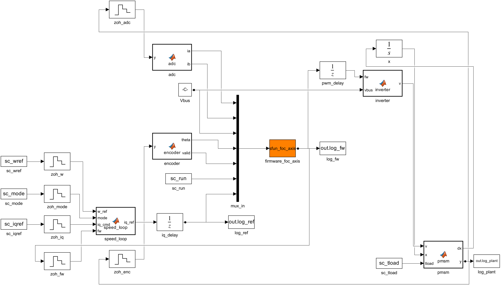
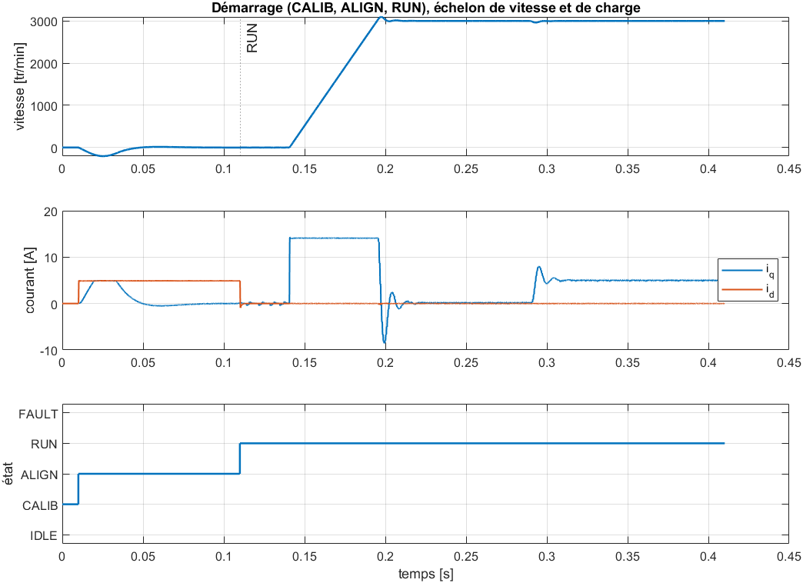
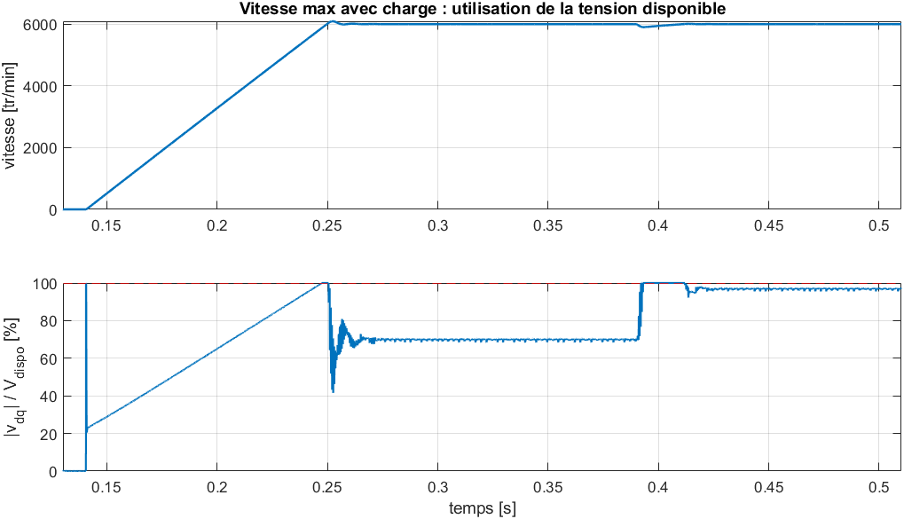

# 12 — Modèle MATLAB / Simulink

Un script MATLAB compile le firmware, génère le modèle Simulink, joue 4
scénarios et vérifie les résultats. Il s'arrête en erreur si un critère n'est
pas tenu (MATLAB R2023a, Simulink).

## Principe : simulation SIL

Le contrôleur simulé **est le code du firmware** : les fichiers C du
firmware sont compilés dans une S-function, que Simulink appelle
toutes les 50 µs, comme l'interruption de l'ADC sur le STM32. Une erreur dans
le C se voit donc dans la simulation (*Software-In-the-Loop*).

Les paramètres du moteur et les gains sont lus dans les fichiers
du projet (paramètres du moteur et en-tête de configuration du firmware) :
Python, Simulink et firmware utilisent les mêmes valeurs.

| Bloc | Modélisation |
|---|---|
| Moteur | PMSM en repère dq, mécanique avec inertie, frottement et couple de charge |
| Onduleur | tensions moyennes sur une période PWM, appliquées une période après le calcul |
| Mesures | ADC 12 bits (±16,5 A), offsets ; codeur AS5047P 14 bits |
| Firmware | `foc_axis_isr()` à 20 kHz : calibration, alignement, boucle de courant |
| Boucle de vitesse | PI à 2 kHz |

## Résultats

| Scénario | Résultat | Attendu |
|---|---|---|
| Échelon de courant de 10 A | dépassement **2,6 %**, établissement **325 µs** | 2,6 % et 380 µs (calcul et test C) |
| Démarrage complet, 0 → 3000 tr/min, charge 0,1 N·m | erreur d'alignement **0,16°**, erreur de vitesse nulle | — |
| 6000 tr/min sous 0,25 N·m | vitesse tenue avec **97 %** de la tension disponible | 95 % calculés |

À 6000 tr/min, la tension sature brièvement lors d'un échelon de charge : la
marge est faible avec ce moteur. Il faudra du défluxage, ou limiter la vitesse
maximale.

## Deux défauts trouvés dans le firmware

La simulation a révélé deux défauts que les tests C ne pouvaient pas voir.

**1. Alignement du rotor faux de 20°.** Pendant l'alignement, rien n'amortit
le rotor : il oscille à 14 Hz et l'angle mémorisé à la fin est faux.
- Correction : un **amortissement actif**. Le firmware injecte `iq = −Kd·ωe` pendant l'alignement, avec Kd calculé pour un amortissement de 0,7.
- Résultat : erreur de 0,16°.
- Une montée progressive du courant avait d'abord été essayée : elle aggravait l'erreur (57°).

**2. Seuil de surintensité non mesurable.** Le seuil valait 21,2 A, alors que
la mesure sature à 16,5 A : la protection ne pouvait jamais se déclencher. Il
est maintenant calculé à 95 % de la pleine échelle, soit **15,7 A**.

## Limites

Onduleur moyen, sans temps morts ; moteur sans saturation magnétique. La
boucle de vitesse est écrite dans le modèle : elle n'est pas encore dans le
firmware.
